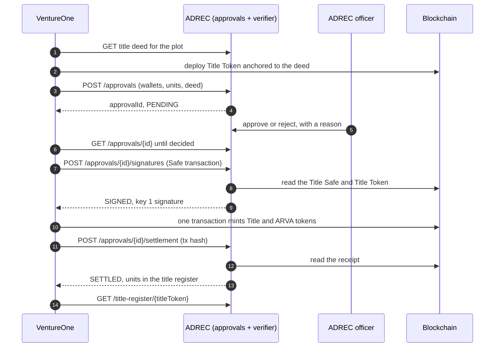

In the dual-token model every investor holds two tokens for the same property: a **Title Token**, ADREC's on-chain record of who owns each fraction, and an **ARVA Token**, the investor's economic share. This section defines the APIs VentureOne requires from ADREC so that **no Title Token moves without ADREC**.

<Info>
  Built and tested against VentureOne's regulator service, a stand-in for ADRES, on Ethereum Sepolia (14–17 Oct 2026). Paths, fields and error codes below are what that service implements, proposed as the contract for ADREC's own APIs.
</Info>

## Who holds what

| Party | Holds | Role in these APIs |
| --- | --- | --- |
| **ADREC** | Key 1 and key 2 of every **Title Safe** (a 2-of-3 multisig that owns the Title Token) | Approves or rejects each request; its **verifier** checks the Title Safe transaction and signs with key 1; registers each settled mint |
| **VentureOne** | The third Title Safe key, and the ARVA Safe | Files requests, sends the transaction for ADREC's signature, reports the mined transaction |

Two kinds of credential, never interchangeable:

| Credential | Used by | May call |
| --- | --- | --- |
| **Platform token** | VentureOne's orchestrator | File, read, request a signature, report a settlement, read the title register |
| **Officer token** | An ADREC officer | Read, approve or reject, read the audit trail, read the title register |

VentureOne can never approve its own request; an officer can never file one.

## The flow

<Steps>
  <Step title="Title deed">
    Before deploying the Title Token, VentureOne reads the property's title deed and hashes the PDF. The token is deployed with the deed's **anchor** as its document URI.
     → [Title deed](/endpoints/title-deed)
  </Step>
  <Step title="File a request">
    VentureOne files one approval request per batch of investors: wallets, units, the Title Safe, the Title Token and the deed.
     → [File an approval request](/endpoints/approvals-file)
  </Step>
  <Step title="Officer decides">
    An ADREC officer approves or rejects it, with a reason. VentureOne polls; ADREC never calls VentureOne.
     → [Approve or reject](/endpoints/approvals-decide) · [Read approval requests](/endpoints/approvals-read)
  </Step>
  <Step title="ADREC co-signs">
    VentureOne sends the Title Safe transaction it built. ADREC's verifier rebuilds its hash and checks it against the approval and the chain, then signs with key 1.
     → [Request ADREC's signature](/endpoints/approvals-sign)
  </Step>
  <Step title="Settlement">
    Once the transaction is mined, VentureOne reports its hash. ADREC reads it from its own node, checks it, and enters the units in its **title register**.
     → [Report a settlement](/endpoints/approvals-settlement)
  </Step>
  <Step title="Reconciliation">
    VentureOne compares every wallet across its records, ADREC's title register and both tokens' balances, at completion and nightly.
     → [Title register](/endpoints/title-register)
  </Step>
</Steps>

## How many requests ADREC receives

An approval request covers **one batch** of investors in **one offering**: one officer decision, one ADREC signature, one blockchain transaction.

| | Requests |
| --- | --- |
| An offering with up to 100 investors | **1** |
| An offering with 250 investors | **3**: 100, 100, 50 |
| Four offerings closing on the same night | At least **4**: one per offering, more for offerings above 100 investors |

- The batch size is VentureOne's setting: 100 by default, at most 198. One Safe transaction carries at most 200 calls (one whitelist update, one mint per investor, one whitelist reset).
- Each offering has **at most one request open at a time**. Its next batch is filed only after the previous one is minted, so ADREC never sees more pending requests than offerings closing.
- One investor appears once per request: an investor with several subscriptions gets one allocation of their total.

See [Recommendations](/introduction/dual-token-recommendations) for approving a whole offering at once.

## Request lifecycle

| State | Meaning | Next |
| --- | --- | --- |
| `PENDING` | Filed; waiting for an officer | `APPROVED`, `REJECTED` |
| `APPROVED` | An officer approved it; nothing signed yet | `SIGNING` |
| `SIGNING` | ADREC is signing one specific transaction | `SIGNED`, or back to `APPROVED` if signing failed definitively |
| `SIGNED` | Key 1's signature is delivered | `SETTLED`, or back to `APPROVED` when its batch settles with allocations left to mint |
| `SETTLED` | The mined transaction was checked; units are in the title register | — |
| `REJECTED` | An officer rejected it | — |

<Warning>
  **One transaction at a time.** While an approval is signing a Safe transaction, it cannot sign another, however similar. A request not decided within its validity (72 hours today) expires and must be filed again.
</Warning>

<Info>
  **One approval per raise, minted in batches.** The officer approves every allocation of a raise at once. A Safe transaction carries only so many mints, so VentureOne mints them in batches under that approval: each batch is named in the [signature request](/endpoints/approvals-sign), checked to be a part of the approval not minted yet, co-signed, and [settled](/endpoints/approvals-settlement) on its own. No allocation is minted twice, and every batch must be signed within the minting window (`mintBy`).
</Info>

## Approval types

| `approvalType` | Payload | Status |
| --- | --- | --- |
| `PRIMARY_ISSUANCE` | `allocations[]`: wallet and units per investor | Built and settled end to end |
| `SECONDARY_TRANSFER` | `transfer`: from, to, units | Filing and approval only; settlement not built |
| `DOCUMENT_ANCHORING` | `documents[]`: name, URI, hash | Filing and approval only; settlement not built |

## Error codes

These add to the [Reference Data](/endpoints/reference-data) `errorCode` table.

| `errorCode` | HTTP | Meaning |
| --- | --- | --- |
| `1000` | 422 | Validation failed, or a check refused the request; `responseMessage` names the check |
| `1401` | 401 | Missing or unknown token |
| `1403` | 403 | The token's role may not do this (VentureOne approving, an officer filing) |
| `1404` | 404 | No such approval, or dual-token approvals are not enabled |
| `1409` | 409 | Conflict: the approval changed meanwhile, is already used, or the transaction settled another approval |
| `1423` | 422 | The filing's title deed is not the registry's |
| `1424` | 422 | The filing names no title deed |
| `1425` | 425 | The reported transaction is not mined yet on ADREC's node; report it again later |
| `1503` | 503 | ADREC's node or custody did not answer; retry |
